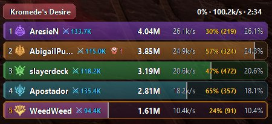

# WeedDPSMetter — DPS Aion 2

<p align="center">
  <strong>Uma solução leve para a comunidade de Aion 2: apenas um DPS Meter limpo, rápido e direto ao ponto, sem elementos extras poluindo a tela.</strong>
</p>

<p align="center">
  
</p>

---

## ✨ Funcionalidades

- **Medição em tempo real:** Dano total, DPS individual e do grupo, taxa e contagem de críticos (`% (hits)`), participação (`%`), Combat Power (`CP`) e contador de mortes.
- **Barra do alvo / chefe:** Exibe nome do alvo, porcentagem de HP, DPS total da luta e cronômetro.
- **Modo Só Boss (`👑` / `🎯`):** Permite focar apenas nos chefes de dungeon ou registrar qualquer alvo normalmente.
- **Jogadores e Skills (`📊` / `👥`):** Alterne facilmente entre o ranking da party/raid e o detalhamento das suas habilidades (incluindo ícone e taxa de crítico por skill).
- **Leve e discreto:** Overlay transparente com aceleração via DirectComposition para rodar por cima do jogo sem pesar no FPS.
- **Trava Click-Through (`F8` / `🔒`):** Trava o medidor para você clicar normalmente no jogo através dele.
- **Reset automático:** Zera os dados anteriores automaticamente ao entrar ou sair de dungeons, trocar de mapa ou trocar de personagem.

---

## 🎮 Controles Rápidos

Passe o mouse sobre a barra superior para exibir os botões:

| Controle | Ação |
| :--- | :--- |
| **`F8`** ou **`🔒` / `🔓`** | Ativa/desativa o modo Click-Through (trava cliques na tela) |
| **Arrastar (botão esquerdo)** | Move o overlay para onde preferir (quando destravado) |
| **Clique na barra / `📊`** | Alterna entre **Jogadores** e **Habilidades** |
| **Botão direito** | Edita nome do personagem ou CP manualmente |
| **`👑` / `🎯`** | Alterna entre **Só Boss** e **Todos os Alvos** |
| **`🔄`** | Reseta os dados do combate atual |
| **`⏸` / `▶`** | Pausa ou retoma a leitura |
| **`⚡`** | Alterna entre renderização DirectComposition e modo clássico |
| **`✕`** | Fecha o medidor |

---

## 🚀 Como Usar (Windows)

### Pré-requisitos
- **[Npcap](https://npcap.com/#download)** instalado *(marque a opção "Install Npcap in WinPcap API-compatible Mode")*
- **[Wireshark](https://www.wireshark.org/)** instalado no caminho padrão (`C:\Program Files\Wireshark\tshark.exe`)
- **Python 3.10+** *(caso rode pelo código-fonte)*

### Executando pelo código-fonte

```bash
git clone https://github.com/igors1lva/Aion-2-Weed-Metter.git
cd Aion-2-Weed-Metter
pip install -r requirements.txt
```

Abra o terminal **como Administrador** e execute:

```bash
python aion2_overlay.py
```

### Gerando o executável `.exe` (opcional)

```bash
pip install pyinstaller
pyinstaller Aion2_DPS_Meter.spec --noconfirm
```

O arquivo compilado será gerado em `dist/Aion2_Weed_Metter.exe`.

---

## 📄 Licença

Projeto aberto para a comunidade sob a licença [MIT](LICENSE).
